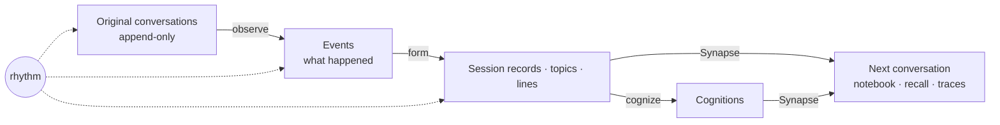

# Memory Harness

[中文](README.md)

> “Some things, I don't want to start over from scratch next time.”

Memory Harness lets an AI assistant remember what it has been through with its user — across sessions, tools and projects — and every memory traces back to the original words.

It wraps the assistants you already use: Claude Code, Codex and dsh today. The assistant works as usual; in the background, Memory Harness reads the conversations, turns them into memories that can be recalled, and brings them back when the next conversation starts.



## What makes it different

### One “I” across hosts and projects

Whatever model or tool is in use today, the “I” in memory is the same assistant. The program stamps every record with two layers of context:

- **the “I” back then**: model, platform, working directory and time of the original conversation;
- **the “I” looking back**: the model, prompt and isolation used to process it.

An agent reading the record months later knows the conditions under which that judgment was made.

### Every statement has a source

Three invariants hold the system together, and `mh check` verifies them by program:

1. **Originals are append-only**: conversations are kept verbatim, with addresses back to the host's original files;
2. **Derived records cite their sources**: every observation points to the text it read and the model and prompt version that produced it;
3. **Supersede, never overwrite**: a new understanding points to the old one, and the old one stays readable.

Recall is therefore more than a remembered conclusion. From a handle such as `L3:T5:S1` you can walk all the way back to what was actually said.

### History is replayed in order, not flattened into “now”

Memory is formed by replaying sessions from the earliest, each step seeing only the history before it. What formed first appears first; later revisions and reversals are kept in the order they happened, so the supersession chain is a real timeline. With a better model you can re-read the same history and keep both readings.

### Reading with different depths

Not every conversation deserves a word-by-word read. observe previews first, then decides on a precise read, a rough read, or none, spending model quota where it matters. rhythm drives the observe, form and tidy loops on wall-clock time and picks models by remaining quota.

### Strict inside, human outside

The further in, the stricter and more mechanical: the program locates citations, supersession is auditable, and model outputs are never scored. The further out, the more human: memories arrive as the assistant's own recollection, and a word that memory has never seen gets an honest “doesn't ring a bell” instead of a guess:

```text
<memory-harness>
「thinkterm」没印象，记忆里还没有，当新的看。
</memory-harness>
```

(“No memory of ‘thinkterm’ yet — treat it as new.”) Writing and recall share one set of expression rules that keep authors, addressees and readers apart and preserve who said each quote.

### The notebook brings back the flyleaf and recent progress

Each time a session connects, it receives a notebook: the flyleaf (`core.md`, also called the core), recall tool instructions, recent status and the current environment, in that order. Recent status lists recently paused sessions with topic handles to help resume work. With core-editing hooks enabled, the core is normally read-only; the user can authorize edits for one turn with `/mhcore` (`$mhcore` in Codex), and changes are appended to a kernel log. See [the usage guide](design/global/使用.en.md#core-and-session-start-context) for installation and host support.

### A supplement to the host's own memory

A host's memory, if it has one, is only RAM: current rules, preferences and project state, loaded whole every time.
In Memory Harness, the core is firmware: hard to change, stable in nature, always present. It is the underlying character and behavior of the AI assistant you work with.
In Memory Harness, recent status and the current environment are RAM: they complement the host's memory, and a deployment can deduplicate them in its own way.
In Memory Harness, engram is the SSD: the full history — how things happened, why, the back-and-forth, the original words — across hosts and workspaces, accumulating over time. It does not compete on recalling today's rules; it does what host memory cannot: long-span reading (how something came to be, phase summaries, timelines) and recall across projects and tools.

### Mistakes are correctable and leave a trail

The system expects to make mistakes, but keeps them bounded, correctable and not repeated once traced. A mistake is corrected at the layer where it happened, as a new record citing the original text — never a silent overwrite. Evaluation avoids scores too: the program finds moments where the user had to explain something again and leaves them for a person to look at.

## Three ways to recall

| Tool | Meaning | What it does |
|---|---|---|
| `evoke` | A few words call up a memory | Through a few words, recall related topics and statements |
| `relive` | Go back to that point and read what came before and after | Expand a handle, down to the original words when needed, back to where the discussion happened |
| `roam` | Walk through memory one level at a time | Browse by workspace, line and topic when you don't know which word to try |

The three tools are split by direction, not by level of detail: `evoke` searches across memory, ranks by relevance and returns full statements on a hit; `relive` reads by position, giving the statements around one statement or a topic in order, and can follow evidence down to the original words; `roam` follows structure without a query. They were first called search, get and map, like grep, open and ls. Once statements became short, search already returned full text and get lost its purpose, so the split changed to direction and the names changed with it: read would be confused with the hosts' built-in Read tool, and search, open and map were too common. As when Synapse was picked from candidates such as Surface, the names are symbols rather than metaphors, and avoid words that suggest something else: they describe not the act of retrieval but how memory is evoked, relived and roamed.

They plug into hosts as MCP tools and also work from the command line: `mh evoke`, `mh relive`, `mh roam`.

## Status

Under active development; mainly for Linux, Chinese-language conversations and local use.

- **Working**: collection, observation, session records and topic lines, notebook delivery, MCP recall, traces and feedback, integrity checks.
- **In progress**: automatic cognition from session records and topic lines, Atlas map rebuilding and unified scheduling. Per-turn association is recorded but not delivered; “no memory of this word” hints are delivered.

The bundled Claude Code, Codex and dsh adapters are ready-to-use examples. To support another harness, write your own adapter following them.

## Getting started

```sh
python3 -m pip install --no-cache-dir --no-build-isolation .
mh --help
```

Requires Python 3.11 or later. Instance configuration, model calls, host integration and optional tools are covered in [Install, configure and integrate](design/global/使用.en.md).

For the internal structure, source tracing and correction mechanisms, see the [design documents](design/INDEX.md) (Chinese). They distinguish the current implementation from planned work.

Development and tests: `python3 tools/test.py`. Tests run in temporary directories with synthetic data and no real model calls. Contributor rules are in [AGENTS.md](AGENTS.md).

Licensed under Apache-2.0; see [LICENSE](LICENSE).
