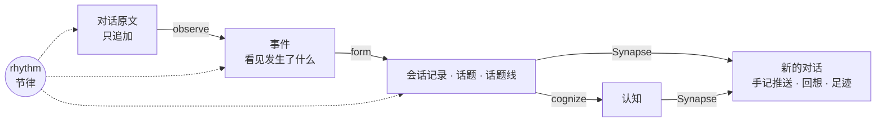

# Memory Harness

[English](README.en.md)

> “有些东西，我不希望下一次重新从头开始。”

Memory Harness 让 AI 助手记住它和用户一起经历过的事。记忆不分会话、不分工具、不分项目，每一句都能追回当初的原话。

它套在你已经在用的助手外面，目前支持 Claude Code、Codex 和 dsh。助手照常工作，它在后台读对话，把经历整理成可以回想的记忆，下一次对话开始时再送回去。



## 它的不同之处

### 同一个“我”，跨宿主、跨项目

无论今天用的是哪个模型、哪个工具，记忆里的“我”都是同一个。每条记录由程序标两层环境：

- **当时的“我”**：原对话的模型、平台、工作目录、时间；
- **回看的“我”**：做这次整理的模型、提示词和隔离方式。

几个月后读到这条记录的 agent，能知道当时的“我”是在什么条件下得出这个判断的。

### 每句话都说得出出处

整个系统靠三条不变量撑着，`mh check` 用程序逐条检查：

1. **原文只追加**：对话保持原样，带着回到宿主原始文件的地址；
2. **派生物带来源**：每条观察都指向它读过的原文，以及产生它的那一版模型和提示词；
3. **只取代，不覆盖**：新的理解指向旧的，旧的仍然可读。

所以回想不止“记得结论”。从一个句柄（如 `L3:T5:S1`）出发，可以一路走回当时的原话。

### 历史按时间回放，而不是压成一个“现在”

形成记忆时，从最早的会话开始逐个回放，每一步只看得到当时之前的历史。先形成的先出现，后来的修订和推翻也按实际顺序留下，取代链就是真实的时间线。换了更好的模型，可以重看同一段历史，得到另一种理解，旧的结果仍然保留。

### 读得有深有浅

不是每段对话都值得逐字读。observe 先预览，再决定精读、粗读还是不读，把模型额度花在值得的地方。rhythm 按墙钟时间驱动观察、形成、整理三个循环，并根据剩余额度挑选模型。

### 内部像程序，外部像人

越往内越严格、越机械：引用由程序定位，取代关系有据可查，不给模型输出打分。越往外越像人：记忆以“我”回想的口吻送到对话里；遇到记忆里没有的词，就坦白说没印象，不去编：

```text
<memory-harness>
「thinkterm」没印象，记忆里还没有，当新的看。
</memory-harness>
```

写进记忆和读出记忆共用一套表达规范，作者、受话人和读者分开记，引语保留原来的说话人。

### 手记带回扉页和最近的进展

每次会话接入时送一份手记：依次是扉页（`core.md`，也叫内核）、回想工具说明、近况和当前环境。近况列出最近停下的会话，带上话题句柄，方便接着做。启用内核态钩子后，内核平时只读，用户可以用 `/mhcore`（Codex 中是 `$mhcore`）临时授权这一轮修改，改动追加到内核日志。安装方法和宿主支持情况见[使用说明](design/synapse/设计.md#内核态)。

### 是宿主自带的记忆的补充

宿主的记忆（如果有的话）只是 RAM：当前的规则、偏好、项目现状，每次整份加载。
Memory Harness 中的 core 是系统固件：难以修改，性质稳定，永远都在。它是和你相处的 AI 助手的性格和行为底色。
Memory Harness 中的 近况和当前环境是 RAM：可以和宿主的记忆互补，部署的时候可以按照自己的方案去重。
Memory Harness 中的 engram 是 SSD：全部经历，包括经过、理由、反复和原话，跨宿主、跨工作区，按时间累积。它不和宿主比谁更快想起当前规则，专做宿主做不到的：长时间跨度的阅读（来龙去脉、阶段总结、时间线）、跨项目和跨工具的回想。

### 错了能改，改了留痕

系统接受自己会出错，但错误要可控、可纠正，查清来源后不再犯。哪一层出的错，就在哪一层改：纠正写成一条新记录，说明依据哪段原文，不悄悄覆盖。评估也不靠分数：程序找出用户不得不重新解释一遍的时刻，交给人看。

## 回想的三种方式

| 工具 | 含义 | 做什么 |
|---|---|---|
| `evoke` | 唤起：几个词勾起一段记忆 | 通过几个词，想起相关的话题和陈述 |
| `relive` | 重温：回到那一处，按先后读前后文 | 按句柄展开，必要时走回原话，回到当时讨论的现场 |
| `roam` | 漫游：在记忆里一层层走 | 不知道从哪个词入手时，按工作区、话题线、话题逛 |

三个工具按方向分，而不是按详略分：evoke 横着找，按相关度排，命中就给陈述全文；relive 按位置读，一条陈述给它前后几条，一个话题按顺序读，可以一路走到依据和原话；roam 按结构走，不查词。它们原来叫 search、get、map，像 grep、open 和 ls。陈述变短以后，search 已经给了全文，get 就失去了意义，于是改成按方向分，也借这个机会改了名字：叫 read 会和宿主自带的 Read 工具混，叫 search、open、map 又太常见。和当初从 Surface 等候选里挑出 Synapse 一样，名字取的是象征，不是比喻，也避开会让人想到别的东西的词：说的不是检索这个动作，而是记忆怎样被唤起、被重温、被漫游。

它们以 MCP 工具的形式接进宿主，命令行里也能用：`mh evoke`、`mh relive`、`mh roam`。

## 现状

项目仍在持续开发，主要面向 Linux、中文对话和本地使用。

- **已经能用**：采集、观察、形成会话记录和话题线、手记推送、MCP 回想、足迹与反馈、完整性检查。
- **还在做**：从会话记录和话题线自动形成认知、Atlas 地图重建、统一的节律调度。逐轮联想目前只记录不送达，“没印象”的新词提示照常送达。

内置的 Claude Code、Codex、dsh 适配是开箱即用的范例。接入别的 harness 时，照着它们写自己的适配即可。

## 开始使用

```sh
python3 -m pip install --no-cache-dir --no-build-isolation .
mh --help
```

需要 Python 3.11 或更新版本。实例配置、模型调用、宿主接入和可选工具见 [安装、配置与接入](design/global/使用.md)。

想了解内部结构、来源追溯和修正机制，见[设计文档](design/INDEX.md)。文档区分当前实现与后续方向。

开发与测试：`python3 tools/test.py`。测试使用临时目录和合成数据，不调用真实模型。协作约定见 [AGENTS.zh-CN.md](AGENTS.zh-CN.md)。

许可证为 Apache-2.0，见 [LICENSE](LICENSE)。
