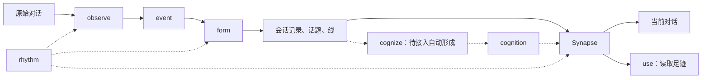

# 总体设计

[← 设计索引](../INDEX.md)

## 目标与模块

Memory Harness 的目标是让历史能够参与现在，并且每一句认识都能追回它的形成来路。它套在已有助手外面，采集原始对话，形成可回想的结构，再通过宿主适配送回对话。

| 模块 | 职责 | 边界 |
|---|---|---|
| [Engram](../engram/设计.md) | 留下原话、观察、形成与认知的历史 | 三个过程写 Claim |
| [Synapse](../synapse/设计.md) | 推送、拉取、导航与足迹 | 只读 Claim，只追加 use；记录纠正转交 Engram |
| [rhythm](../rhythm/设计.md) | 决定何时运行、并行几个、可用额度 | 不决定一批读什么、怎样形成 |
| [表达](../express/设计.md) | 写入和读取共用的视角与模板 | 不推断人物身份，不新增认识 |

## 三条不变量

1. **原文只追加。** 采集到的对话保留原样，带回到宿主原始文件的位置。用户明确要求删除时走有记录的删除流程。
2. **派生物带来源。** 每条观察指向读过的原文，以及产生它的模型、提示词、隔离方式和影响输入的参数。
3. **只取代，不覆盖。** 新理解写成新记录，指向被取代的旧记录；旧记录仍可追溯。

`mh check` 检查原文哈希、来源引用、关系端点、时间顺序、取代链及覆盖，并通过快照发现绕过写入约束的改动。检查只列可观察事件和计数，不给模型输出打质量分。

## 程序与模型的分工

| 程序 | 模型 |
|---|---|
| 发现会话、解析格式、标注宿主注入、去重、切块和增量游标 | 阅读材料，写下发生了什么与原文中的限定 |
| 定位来源、保存调用、检查引用和取代链 | 判断新旧内容的关系、给目标和主题起名 |
| 检索、统计、呈现不同 Operator 的结果 | 从经历中提出新的解释，保留推断身份 |

不确定、没做和不适用分别记录，不默认成某个结论。模型形成的解释不会因为存进系统就成为用户的观点或已验证事实。

## “我”与来源环境

个人助手场景中，不同模型、平台的记录围绕同一个“我”组织。每条派生记录区分两层环境：

- **当时的我**：原对话的模型、平台、工作目录、时间。
- **回看的我**：进行观察或形成的模型、平台与 Operator。

认识保留“当时”的视角。相对时间由读取时计算；把当时的判断整理成长久认识，是一次新的形成，不修改历史。具体名字、别名与称呼偏好来自私有实例配置。

## 按时间回放

历史从早到晚处理，每一步只看当时之前可用的材料。形成的取代链因此保留认识实际改变的顺序。

- **复现**使用保存的版本、参数和实际输入查错；模型调用不保证逐字相同。
- **重看**用新的 Operator 重新阅读同一份历史，得到另一种 View，旧结果仍保留。
- **纠正**由申请触发，按申请范围取代旧结果。是否取代由原因与目标决定，不由模型版本是否相同决定。

每份产出写明来源，允许不同来源版本并用。上游变化只通知直接相邻的一层，等被用到时再处理，见[修正机制](../engram/申请.md)。

**写入时不追求正确理解全部历史。** 每一层保存足以以后重新理解的依据，理解可以延后，也可以在不同尺度下重读；不要求写下的那一刻就分对、看全。很多写入时做不到的要求因此不再是要求，比如逻辑会话（见 [form](../engram/form/设计.md) 的“分层”）。

## 并发会话

并发会话可以按 Git 分支理解：开场送达的认识是会话起点，会话形成新的认识，再合回全局。设计要求保存送达版本，区分本次显式修改和其他会话期间的改动。完整的三方合并机制尚未实现。

送达记录只能证明给过什么内容，不能证明模型理解了什么或有意改变了什么。矛盾允许显式并存，不必在合并时强行解决，也不能悄悄覆盖。

## 借上一层的视野

每一层要产出得好，需要上一层那么大的视野；作用域仍是本层，写下的只是本层的东西。视野是输入，作用域是输出：借来的视野不让下一层越界，越不过的那部分由上一层自己做。

- **observe**：事件一次读一轮或几轮，先由预览在会话的尺度上（form 的视野）看一遍，定下哪些读、怎么读；预览是 observe 自己的，写出的仍是这几轮的事件。
- **form**：挂线时看骨架（人工核对过的认知）和已有的线，写的仍然只是自己这段会话；跨会话的合并归 cognize。form 还没有自己的“预览”：骨架和候选现在直接附给挂线，没有设计过先在上一层的视野上看一遍、再定怎么形成。
- **cognize 给 form**：除了骨架，候选认知怎样作为视野给 form 还没定，见 [cognize](../engram/cognize/设计.md)。

## 与宿主记忆互补

| | 宿主记忆 | Memory Harness |
|---|---|---|
| 主要内容 | 当前规则、偏好、项目状态 | 全部经历、经过、理由、反复与原话 |
| 使用方式 | 通常随会话加载 | 按需查询，新记录要等形成追上 |
| 时间 | 当前工作集 | 可追溯的历史与版本 |
| 范围 | 依宿主而定 | 跨宿主、跨工作区 |

手记承担稳定上下文和最近进展；更长时间的来龙去脉通过拉取获得。宿主记忆的写回、引用关联与过期提示仍是后续方向。

## 评估与改进

评估关心用户是否需要重新解释已经说过的事。设计方向是由程序找出可追溯的具体事件，交给人判断：某条认识没有曝光、曝光后没有回应，或送达的认识造成误导。访问树已实现，完整的“记忆时刻”识别尚未完成。

曝光、访问路径、显式引用都是可记录的事实；“用上了”“读懂了”不由模型自评推断。离线回放可以比较当时可用的记忆与后来的会话，结果应明确标为离线证据。

新的区分、门槛和字段由实际问题推动。纠正应能说明改了什么、依据什么；兜底只处理已有证据支持的偏差。

## 公开与私有边界

公开仓库提供程序、合成测试、提示词、宿主适配和项目说明。实例配置、profile、真实对话、运行数据及私有 Git 历史留在仓库外。

采集保留原文，表达模块也不承诺匿名化。向外发布材料需要单独筛选；源码运行时可按 `design/` 的目录构造项目骨架，并读取通用词典；个人内核与项目现状仍由私有资源提供。
