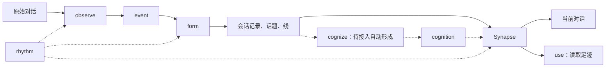

# 总体设计

[← 设计索引](../INDEX.md)

## 目标与模块

Memory Harness 的目标是让历史能够参与现在，并且每一句认识都能追回它的形成来路。它套在已有助手外面，采集原始对话，形成可回想的结构，再通过宿主适配送回对话。

| 模块 | 职责 | 边界 |
|---|---|---|
| [Engram](../engram/设计.md) | 留下原话、观察、形成与认知的历史 | 三个过程写 Claim |
| [Synapse](../synapse/设计.md) | 推送、拉取、导航与足迹 | 只读 Claim，只追加 use；记录纠正转交 Engram |
| [rhythm](../rhythm/设计.md) | 决定何时运行、并行几个、可用额度 | 不决定一批读什么、怎样形成 |
| [表达](../express/设计.md) | 写入和读取共用的视角与模板 | 不推断人物身份，不新增认识 |

设计目录按模块分，与代码包一一对应。**目录设计加词典就是工作区的骨架**：目录说有哪些部分、怎么分层，词典说每个部分里的东西叫什么、指什么、为什么这么叫。词典按模块分节、和目录对应，接手一块时只读自己负责的那一节，就明白一大截；进度、规矩、还没名字的东西不在里面。form 挂线取的也是这份层级里人工定下的部分（[form](../engram/form/设计.md#骨架)）。

## 三条不变量

最底下是一条：**不静默**。运动是绝对的，发生是不可撤销的：什么都可以变、可以丢、可以删，但变化本身留下记录，不悄悄发生（怀特海所说过去“客观不朽”，物理上擦除也要留下热量）。`mh check` 的覆盖检查查的就是哪一层静默丢了东西。下面三条是它在现在这套形态上的写法。

1. **原文只追加。** 采集到的对话保留原样，带回到宿主原始文件的位置。用户明确要求删除时走有记录的删除流程。轮是对原文的一种切法，属于派生物：换切法是带版本的新派生、取代旧的，不动原文（现在的实现仍以轮次哈希作原文 ID）。
2. **派生物带来源。** 每条观察指向读过的原文，以及产生它的模型、提示词、隔离方式和影响输入的参数。
3. **只取代，不覆盖。** 新理解写成新记录，指向被取代的旧记录；旧记录仍可追溯。

`mh check` 检查原文哈希、来源引用、关系端点、时间顺序、取代链及覆盖，并通过快照发现绕过写入约束的改动。检查只列可观察事件和计数，不给模型输出打质量分。

## 底线与退出

mh 自身结构里有几条底线，断了 mh 就退出：后继另起名字，mh 的全部记录作为它的原始来源，不把名字留给一个已经不是它的东西。允许退出，是为了能坚持这几条：

- **不静默**，和它在现形态上的三条不变量。
- **三原语分开**：发生、表达、做法各自独立，同一份历史能用新做法重看。记忆一旦进了模型参数，做法就没法单独命名、换掉，这条会断。
- **写读不对称**：只有 Engram 的过程写 Claim，读只留足迹；读要改写记忆时走申请。
- **自相似分层**：上层读下层，依赖朝下，对外只交产物、做法可换。

其余都是形态，条件到了就变，变了还是 mh：层数和最底层的单位（轮），按墙钟成批运行的节律，按会话生命周期的推送，以及宿主是交互边界、只有一个用户、单机单库这些现在的前提。

## 记什么、什么时候整理

总的取舍是整理换复用：整理做得越早、越多，查的时候越省，但大多数记忆从来不会被读到。模型的记忆和人的学习有几处不同，决定了这笔账怎么算：

- **学到的在身外。** 人学会了会沉进直觉，用的时候不必先想起来；模型的权重冻结，每次都要过两关：想到要取，取来以后读进去。瓶颈在触发，不在存储。
- **没有疼。** 人吃过亏会记得疼，下次先警觉；每条记忆在模型眼里一样平。哪条更该被想起（没做完的、错过的、用户纠正过的），要靠工程补上轻重。
- **模型越强，值得记的越窄。** 通用知识、从文件和代码推得出的，模型自己有，还在变强，读一遍文件也越来越便宜。记忆要胜过的是“直接读文件”，能胜出的是文件里没有的：为什么（理由和取舍）、没走的路、没做完的事、用户本人（偏好、世界观、会怎么判）。文件里有的程序不记、引用按需分级，都是这一条的落实。
- **分层：内存接热的，长期库接没接住的。** 工作集是内存级（宿主的记忆、手记，开发这一层的前沿），长期库是另一级（Engram 的库）。正在改的、前沿上挂着的没做完的，由内存和原件承担，要执行时读原件最准；长期库接冷了的、跨项目的、从没进过前沿的（理由、没走的路）。没有内存层的工作区，长期库多担一些。
- **带着原则找案例。** 人难在从案例归纳出原则再迁移；模型已经有原则，缺的是“在这里，这条原则落成了什么样”。所以记忆以案例为单位，规则也从案例来。
- **连续性靠读进来的。** 人的一生连续，模型每段会话从头开始；“同一个我”取决于开头和中途读进来什么。记忆对模型不是辅助，就是连续性本身。

由此，整理分三个时候，各做各做得了的：

| 时候 | 手里有什么 | 适合做 |
|---|---|---|
| 写入（observe、form） | 当时的全部原话，不知道以后会问什么 | 全量只做便宜的：自足的陈述、出处、时间、精确键 |
| 事后（整理循环、睡眠） | 后来发生了什么 | 只有事后才看得清的：了没了结、哪条路被证明错了、轻重；只花在后来又被碰到的东西上 |
| 查询（Synapse） | 这一轮在做什么，预算紧 | 对题：按这一轮挑、排、分辨 |

模型越强，查询一侧越便宜，提前整理的价值就越收向事后那两类：看清的和轻重。这两类人靠时间和疼痛自然得到，mh 要专门造。

## 程序与模型的分工

| 程序 | 模型 |
|---|---|
| 发现会话、解析格式、标注宿主注入、去重、切块和增量游标 | 阅读材料，写下发生了什么与原文中的限定 |
| 定位来源、保存调用、检查引用和取代链 | 判断新旧内容的关系、给目标和主题起名 |
| 检索、统计、呈现不同 Operator 的结果 | 从经历中提出新的解释，保留推断身份 |

不确定、没做和不适用分别记录，不默认成某个结论。模型形成的解释不会因为存进系统就成为用户的观点或已验证事实。

## “我”与来源环境

个人助手场景中，不同模型、平台的记录围绕同一个“我”组织。每条派生记录区分两层环境：

- **当时的我**：原对话的模型、平台、工作目录、时间。
- **回看的我**：进行观察或形成的模型、平台与 Operator。

认识保留“当时”的视角。相对时间由读取时计算；把当时的判断整理成长久认识，是一次新的形成，不修改历史。具体名字、别名与称呼偏好来自私有实例配置。

上面讲的是时间上的“我”。身体的那一面：哪些资源“我”按需调用、哪些要用户同意、哪些不碰，这个区分界定了“我”的物理存在；每一档都带条件、随授权移动，移动时显式记下来源。节律和会话也都是“我”：节律接管长任务、到点交回原会话，是“我”提醒自己，不是外部动作（方向，见 [rhythm](../rhythm/设计.md#接管长任务方向)）。

## 按时间回放

历史从早到晚处理，每一步只看当时之前可用的材料。形成的取代链因此保留认识实际改变的顺序。

- **复现**使用保存的版本、参数和实际输入查错；模型调用不保证逐字相同。
- **重看**用新的 Operator 重新阅读同一份历史，得到另一种 View，旧结果仍保留。
- **纠正**由申请触发，按申请范围取代旧结果。是否取代由原因与目标决定，不由模型版本是否相同决定。

每份产出写明来源，允许不同来源版本并用。上游变化只通知直接相邻的一层，等被用到时再处理，见[修正机制](../engram/申请.md)。

**时刻用绝对时间。** 存、比较、切出“一天”都用绝对时间，只在显示的一端按读的人所在时区换算：页面按看页面的浏览器，手记、状态页和日志按本机现在的时区，常驻进程每轮现读，不停在启动时读到的那一份。外面来的时刻先换成绝对的再用。机器换过时区以后，按旧时区编出来的页里，后写下的时刻会比编页那一刻还早；时区还会变，统一在客户端换算。

**写入时不追求正确理解全部历史。** 每一层保存足以以后重新理解的依据，理解可以延后，也可以在不同尺度下重读；不要求写下的那一刻就分对、看全。很多写入时做不到的要求因此不再是要求，比如逻辑会话（见 [form](../engram/form/设计.md) 的“分层”）。

## 并发会话

并发会话可以按 Git 分支理解：开场送达的认识是会话起点，会话形成新的认识，再合回全局。设计要求保存送达版本，区分本次显式修改和其他会话期间的改动。完整的三方合并机制尚未实现。

送达记录只能证明给过什么内容，不能证明模型理解了什么或有意改变了什么。矛盾允许显式并存，不必在合并时强行解决，也不能悄悄覆盖。

## 借上一层的视野

每一层要产出得好，需要上一层那么大的视野；作用域仍是本层，写下的只是本层的东西。视野是输入，作用域是输出：借来的视野不让下一层越界，越不过的那部分由上一层自己做。

- **observe**：事件一次读一轮或几轮，先由预览在会话的尺度上（form 的视野）看一遍，定下哪些读、怎么读；预览是 observe 自己的，写出的仍是这几轮的事件。
- **form**：挂线时看骨架（人工核对过的认知）和已有的线，写的仍然只是自己这段会话；跨会话的合并归 cognize。form 还没有自己的“预览”：骨架和候选现在直接附给挂线，没有设计过先在上一层的视野上看一遍、再定怎么形成。
- **cognize 给 form**：除了骨架，候选认知怎样作为视野给 form 还没定，见 [cognize](../engram/cognize/设计.md)。

## 与宿主记忆互补

| | 宿主记忆 | Memory Harness |
|---|---|---|
| 主要内容 | 当前规则、偏好、项目状态 | 全部经历、经过、理由、反复与原话 |
| 使用方式 | 通常随会话加载 | 按需查询，新记录要等形成追上 |
| 时间 | 当前工作集 | 可追溯的历史与版本 |
| 范围 | 依宿主而定 | 跨宿主、跨工作区 |

手记承担稳定上下文和最近进展；更长时间的来龙去脉通过拉取获得。宿主记忆的写回、引用关联与过期提示仍是后续方向。

## 评估与改进

评估关心用户是否需要重新解释已经说过的事。设计方向是由程序找出可追溯的具体事件，交给人判断：某条认识没有曝光、曝光后没有回应、找到了但细节在形成时被压掉或没展开到原话，或送达的认识造成误导。访问树已实现，完整的“记忆时刻”识别尚未完成。

“用户又提起了”这一问还在验证：第一轮回放显示它分不开“重说”和“接着做”，判法要换。

**不算错过的重说。** 要求说了没落地、用户再说一遍，是知道但没做到，归现状（内存层），不归记忆；同一个问题换了对象再问，是一次简单的提醒，记忆里的形式还没泛化到新对象，不算没想起来。

曝光、访问路径、显式引用都是可记录的事实；“用上了”“读懂了”不由模型自评推断。离线回放可以比较当时可用的记忆与后来的会话，结果应明确标为离线证据。

新的区分、门槛和字段由实际问题推动。纠正应能说明改了什么、依据什么；兜底只处理已有证据支持的偏差。

## 公开与私有边界

公开仓库提供程序、合成测试、提示词、宿主适配和项目说明。实例配置、profile、真实对话、运行数据及私有 Git 历史留在仓库外。

采集保留原文，表达模块也不承诺匿名化。向外发布材料需要单独筛选；源码运行时可按 `design/` 的目录构造项目骨架，并读取通用词典；个人内核与项目现状仍由私有资源提供。
